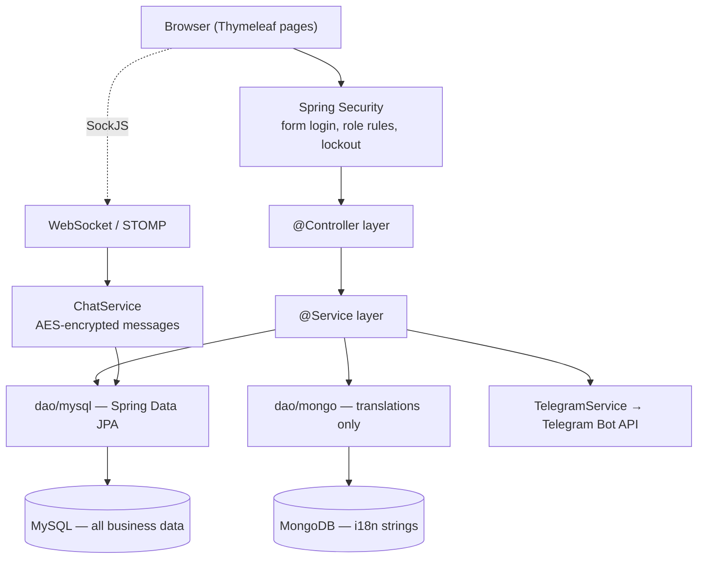

# Architecture

One Spring Boot app, server-rendered with Thymeleaf. Layered
controller → service (`*ServiceImpl`) → DAO, with domain objects in `domain/`.

## Packages

| Package | Role |
|---|---|
| `controller/` | One controller per area (`CartaController`, `PedidoController`, `ReservaController`, …). `ControllerDirects` handles the dashboard, `GlobalControllerAdvice` + `NotificationsList` inject shared model attributes. |
| `services/<area>/` | Interface + `*Impl`. Business rules, transaction boundaries. |
| `dao/mysql/` | Spring Data JPA repositories over the `domain/` entities. |
| `dao/mongo/` | `LanguagesDAO`, `TranslationDAO` — the only Mongo access. |
| `domain/` | JPA entities and enums (`EstadoPedido`, `MetodoPago`, `CategoriaPlato`, …). |
| `security/` | `SecurityConfig`, `CustomUserDetailsService`. |
| `config/` | `MultiDbConfig` (second datasource), `MongoMessageSource` (i18n), `WebSocketConfig`, `TelegramConfig` + `TelegramCheckInterceptor`, `AppLocaleConfig`, auth event handlers. |
| `utils/` | `AESUtil` — AES-128 encrypt/decrypt for stored chat messages, key from `RESTAURANTUS_CHAT_KEY`. |

## Multi-database wiring

`MultiDbConfig` declares the MySQL `EntityManagerFactory` / `transactionManager` explicitly
(because HikariCP with `@ConfigurationProperties` needs `jdbc-url`, not `url`). MongoDB uses
Spring Boot's auto-configuration straight from `spring.data.mongodb.uri`. The two never share a
transaction — Mongo only holds translation documents that `MongoMessageSource` resolves for
Thymeleaf's `#{...}` message lookups, so the UI language can change without a redeploy.

## Auth and lockout

Form login through Spring Security. `LoginAttempt` rows track failures per user;
after `restaurantus.max_login_attempts_until_block` (default 3) the account is blocked.
`ForgotPasswordController` + `SecurityResetService` issue a reset flow. On success,
`CustomAuthenticationSuccessHandler` sends the user to the Telegram-link page if they haven't
connected an account yet.

## Chat

`ChatController` + `WebSocketConfig` expose a STOMP endpoint (SockJS fallback). Messages go
through `ChatService`, which encrypts the body with `AESUtil` before persisting via
`MensajeRepository`, and forwards a copy to Telegram through `TelegramService`. History is
decrypted on read; an undecryptable row renders as `[Texto ilegible]`.

## External services

| Service | Used for | Required? |
|---|---|---|
| Telegram Bot API | staff notifications + the chat bridge | Needs `TELEGRAM_TOKEN_ENV`; the link gate blocks pages without it unless disabled. |
| MongoDB | translation strings | Yes — `MongoMessageSource` reads it on every message lookup. |

No payment provider, no email service (password reset is Telegram-based).

## Tech

| Concern | Choice |
|---|---|
| Language / build | Java 25, Maven (wrapper included) |
| Web | Spring MVC + Thymeleaf, `thymeleaf-extras-springsecurity6` |
| Data | Spring Data JPA (MySQL) + Spring Data MongoDB; H2 on the classpath for tests/demo |
| Realtime | Spring WebSocket + STOMP, SockJS / stomp-websocket webjars |
| PDF | OpenPDF (`PdfService`) |
| Bot | `telegrambots-spring-boot-starter` |
| Crypto | JDK `javax.crypto` AES-128 |
