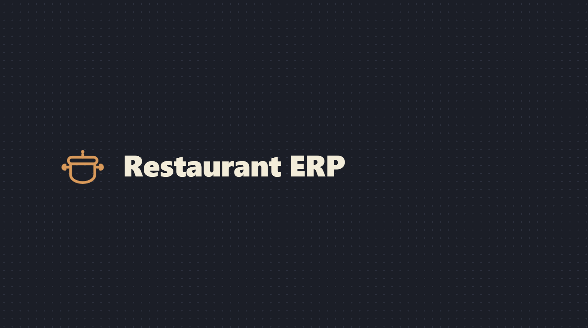
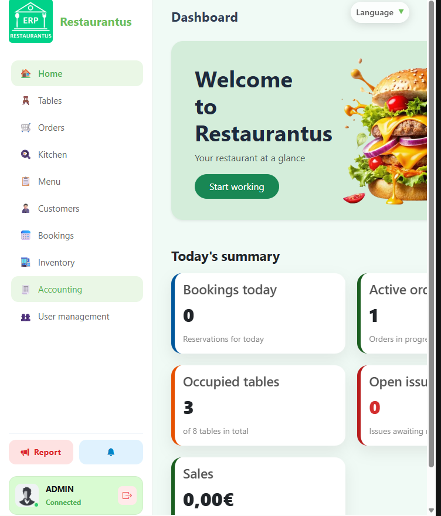
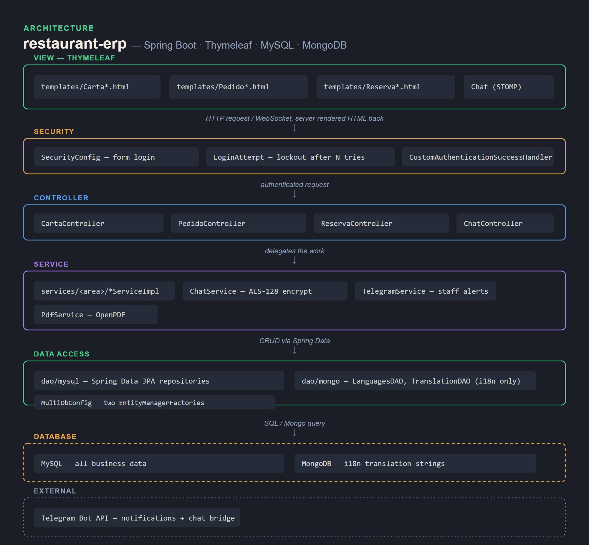

# Restaurantus ERP


A back-office ERP for running a restaurant: the menu and its ingredients, table layout,
reservations, the order-to-kitchen flow, cash reconciliation with PDF invoices, staff incidents,
and an internal chat that also bridges to Telegram. Server-rendered with Thymeleaf, one Spring
Boot app.

**Live demo:** _deploy pending_ — sign in as `admin` / `demo1234`. Runs on a free tier
with in-memory data (H2), so it sleeps when idle and the first request after that takes
~30–50 s. See [docs/DEPLOY.md](./docs/DEPLOY.md) for what the demo profile leaves out.

Built for a DAM (software development) course module — a team project covering Spring Security,
multi-database access, WebSockets and a third-party bot integration.

## What it covers

| Area | What's in it |
|---|---|
| **Carta** | Dishes, drinks and desserts; ingredients, lots (`Lote`) and stock requests; menus that bundle dishes. |
| **Sala** | Table layout by location (`UbicacionMesa`), table state, reservations. |
| **Pedidos** | Take an order, send it to the kitchen, track it through `EstadoPedido`, close it out. |
| **Cocina** | A live pending-orders board for kitchen staff. |
| **Finanzas** | Cash-drawer reconciliation (`ArqueoCaja`), consumption tracking, PDF invoices (OpenPDF). |
| **Incidencias** | Staff incident reports with a resolution workflow. |
| **Usuarios** | Roles, login-attempt lockout, password reset, an activity log per client. |
| **Chat** | Internal staff chat over WebSocket/STOMP, messages stored AES-encrypted, mirrored to a Telegram bot. |
| **i18n** | UI strings live in MongoDB; the language switches at runtime. |

## Two databases

- **MySQL** — everything transactional (JPA, wired manually in `MultiDbConfig` so a second
  datasource can coexist).
- **MongoDB** — only the translation catalogue (`dao/mongo`), read by a custom
  `MongoMessageSource`.

## Run it locally

Needs JDK 25, a MySQL database and a MongoDB instance. All configuration is environment
variables — there are no credentials in the repo:

```bash
export DB_URL="jdbc:mysql://localhost:3306/restaurantus?useSSL=false&allowPublicKeyRetrieval=true"
export DB_USERNAME=root DB_PASSWORD=yourpassword
export MONGODB_URI="mongodb://localhost:27017/restaurantus"
export RESTAURANTUS_CHAT_KEY="0123456789abcdef"   # exactly 16 chars — AES-128 key for chat
export TELEGRAM_TOKEN_ENV="123:abc"               # a BotFather token; the Telegram features need it

./mvnw spring-boot:run
```

Then open `http://localhost:8080`. Hibernate creates the schema (`ddl-auto` default). The
Telegram link-account gate (`TelegramCheckInterceptor`) redirects staff to `/telegram/vincular`
until they connect a Telegram account — see the notes below to loosen that for a demo.

## The demo profile

`-Dspring-boot.run.profiles=demo` (or `SPRING_PROFILES_ACTIVE=demo`) runs the whole app
with no external services: in-memory H2 instead of MySQL, the UI strings from a bundled
English file instead of MongoDB, the Telegram bot off, and a seeded sample restaurant.
This is what the live demo and the Docker image use. Details and logins:
[docs/DEPLOY.md](./docs/DEPLOY.md).

```bash
./mvnw spring-boot:run -Dspring-boot.run.profiles=demo
# or
docker build -t restaurant-erp . && docker run --rm -p 8080:8080 restaurant-erp
```

## Screenshots

From a local run on the `demo` profile (`admin` / `demo1234`).


:---:
Dashboard — today's bookings, active orders, occupied tables, sales

## Architecture



See [ARCHITECTURE.md](./ARCHITECTURE.md) for the layering, the multi-DB wiring and the chat path.

## Contributors

A group project for the DAM course. Handles are GitLab, where the coursework was hosted.

- **Ismael Rosillo** (@rosillodev) — lead
- **Daniel Adanegbe** (@dadanegbe)
- **Zakaria Elmtiouy** (@elmitouy.zakaria)
- **Jack** (@jacka)

## License

PolyForm Noncommercial 1.0.0 ([LICENSE](./LICENSE)). Personal, non-commercial use only.
